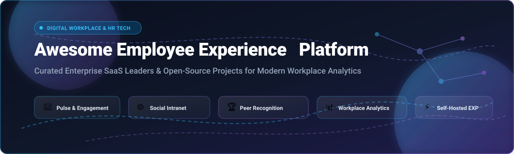

# 🌟 Awesome Employee Experience Platform (EXP) Ecosystem 🚀

  <strong>Curated Directory of Enterprise SaaS Solutions &amp; Open-Source Projects for Digital Workplace, Internal Communications, People Analytics, and Employee Engagement</strong>

  <em>Updated regularly to track top HR tech platforms, pulse survey engines, social intranets, and recognition systems.</em>

---

## 📖 Table of Contents

- [🔍 Sector Overview &amp; Market Dynamics](#-sector-overview--market-dynamics)
- [💼 SaaS/Hosted Platforms](#-saashosted-platforms)
- [🔓 Open-Source GitHub Projects](#-open-source-github-projects)
- [📈 Star History](#-star-history)
- [🤝 How to Contribute](#-how-to-contribute)
- [💖 Support](#-support)
- [⚠️ Disclaimer](#️-disclaimer)

---

## 🔍 Sector Overview & Market Dynamics

The global **Employee Experience Platform (EXP)** market is estimated at approximately **$4.65B to $7.76B** (projected to reach **$11.7B–$15.4B** by the early 2030s with a **9%–11% CAGR**). The sector is **moderately fragmented**, balancing broad workplace ecosystem giants (*Microsoft*, *Salesforce*, *Workday*) that bundle EX with enterprise productivity and CRM suites against agile, specialized pure-play platforms (*Culture Amp*, *Lattice*, *Simpplr*, *Qualtrics*) competing on deep engagement workflows, managerial coaching, and predictive people analytics.

---

## 💼 SaaS/Hosted Platforms

| Platform | Company Valuation / Revenue | Starting Pricing | Free Tier / Free Trial Limits | Description |
| :--- | :--- | :--- | :--- | :--- |
| **[Microsoft Viva](https://www.microsoft.com/en-us/microsoft-viva)** | ~$3.98T Market Cap (Microsoft) | $12.00/user/month (Viva Suite, billed annually); sub-bundles start at $2.00/user/month | Included base features (Viva Connections & basic Insights) with M365/O365 Enterprise plans; 30-day free trial for premium modules | Integrated employee experience suite inside Microsoft 365 and Teams spanning Viva Connections, Insights, Glint, Learning, Amplify, and Goals. |
| **[Salesforce Employee Experience Platform](https://www.salesforce.com/)** | ~$190B Market Cap (Salesforce) | $15.00/user/month (Agentforce Employee / AI service access, billed annually); Service Cloud starting tier at $25.00/user/month | 30-day free trial (Service Cloud / platform trials) | Unified employee experience platform built on Service Cloud featuring HR Service Center, Employee Concierge, and Agentforce self-service workflows. |
| **[Peakon (Workday)](https://www.workday.com/)** | $700M acquisition valuation; ~$48B Market Cap (Workday) | $20,000/year base platform floor (approx. $3.50–$6.00/employee/month at volume) | No permanent free tier; 90-day trial offered periodically via partner programs or guided sales sandbox demos | Continuous employee listening, sentiment tracking, and predictive people analytics platform integrated into Workday HCM. |
| **[Workvivo (Zoom)](https://www.workvivo.com/)** | ~$28.5B Market Cap (Zoom, acquired Workvivo in 2023) | ~$5.00–$10.00/user/month (typical contract floor starting at $20,000/year, billed annually) | No free tier or self-serve trial; live guided sandbox demonstration provided upon sales consultation | Communication-led social intranet and engagement hub featuring mobile activity feeds, livestreaming, recognition, and workplace community tools. |
| **[Qualtrics EmployeeXM](https://www.qualtrics.com/employee-experience/)** | $12.5B acquisition valuation (Silver Lake) | $1,500/month (~$18,000/year starting contract floor for mid-market listening packages) | Free tier available (Qualtrics Surveys: 500 responses, 3 active surveys limit); 30-day free trial for advanced research tiers | Enterprise experience management platform for lifecycle feedback, pulse surveys, 360 reviews, and AI sentiment analytics. |
| **[Lattice](https://lattice.com/)** | $3.0B valuation (Series F) | $11.00/user/month (Performance module, billed annually; $4,000/year minimum spend threshold) | No permanent free tier or self-serve trial; custom guided product demo sandbox on consultation | Performance management, OKRs, career growth planning, and engagement survey platform for modern HR teams. |
| **[Culture Amp](https://www.cultureamp.com/)** | $1.5B valuation (Series F) | ~$5.00–$14.00/employee/month (billed annually; minimum contract entry typically ~$4,500/year) | No permanent free tier or self-serve trial; scheduled interactive product walk-through demo only | People analytics, employee engagement pulse surveys, and science-backed performance review platform. |
| **[Simpplr](https://www.simpplr.com/)** | ~$350M–$500M valuation (Series D) | £4.00/user/month (~$5.00/user/month base intranet tier under public frameworks; standard implementations start at ~$10,000+) | 14-day free trial (sales-coordinated evaluation sandbox) | AI-powered modern intranet and internal communication platform offering personalized feeds, smart search, and employee advocacy. |
| **[15Five](https://www.15five.com/)** | ~$150M–$250M valuation; ~$50M ARR | $4.00/user/month (Engage tier, billed annually); $11.00/user/month (Perform); $16.00/user/month (Total Platform) | 14-day free trial (full platform feature access without credit card) | Manager enablement and performance management platform featuring weekly check-ins, 1-on-1s, OKRs, and pulse surveys. |
| **[Achievers](https://www.achievers.com/)** | $110M acquisition valuation; ~$50M ARR | ~$3.00–$8.00/employee/month licensing (mid/enterprise deployments typically require $50,000–$100,000+ annual spend including reward pools) | No permanent free tier or self-serve trial; guided pilot demonstration on sales scoping | Employee recognition and points-based rewards platform with peer-to-peer social recognition, digital rewards catalog, and analytics. |

---

## 🔓 Open-Source GitHub Projects

Curated self-hosted platforms and open-source frameworks for digital workplace hubs, sentiment analysis, pulse surveys, and employee recognition — ordered by GitHub stars (descending):

1. **[n8n](https://github.com/n8n-io/n8n)**   
   ✨ Fair-code workflow automation platform (TypeScript/Node.js). Widely utilized by People Ops engineering teams to automate employee onboarding, automated Slack/Teams pulse surveys, HRIS synchronization, and experience lifecycle triggers.

2. **[Rocket.Chat](https://github.com/RocketChat/Rocket.Chat)**   
   💬 Open-source team communications hub (GPL-3.0) with matrix federation, omnichannel workplace engagement tools, departmental channels, interactive apps, and integrated employee surveys.

3. **[Mattermost](https://github.com/mattermost/mattermost)**   
   🛡️ Secure, open-source enterprise collaboration and digital workplace platform (Go/React). Features Playbooks, structured collaboration workflows, and plugins for continuous pulse polling and employee check-ins.

4. **[Nextcloud Server](https://github.com/nextcloud/server)**   
   ☁️ Self-hosted productivity and collaboration suite (AGPL-3.0). Serves as a private intranet and digital workplace with Nextcloud Hub, interactive dashboards, file sharing, team talk, calendar, and employee portal integrations.

5. **[Formbricks](https://github.com/formbricks/formbricks)**   
   📝 Open-source experience management and micro-survey platform (AGPL-3.0, Next.js/TypeScript). Self-hosted alternative to Qualtrics for running in-app employee pulse surveys, onboarding feedback, eNPS assessments, and satisfaction analytics.

6. **[Frappe HRMS](https://github.com/frappe/hrms)**   
   👥 Open-source modern HR and employee experience platform (GPL-3.0, Python/JS). Features comprehensive employee self-service portal, lifecycle transitions, performance appraisal cycles, energy points (peer appreciation), and leave management.

7. **[HumHub](https://github.com/humhub/humhub)**   
   🌐 Flexible open-source social intranet and enterprise networking kit (AGPL-3.0, PHP/Yii). Enables organizations to deploy employee directories, social feeds, space-based collaboration, recognition posts, and custom team modules.

8. **[erxes](https://github.com/Erxes/Erxes)**   
   🚀 Source-available experience management operating system (TypeScript). Positions itself as an open Qualtrics + HubSpot alternative with dedicated employee experience modules, task tracking, surveys, and engagement automation.

9. **[Plone CMS](https://github.com/plone/Products.CMFPlone)**   
   🏛️ Battle-tested enterprise open-source content management system and intranet framework (GPL-2.0, Python). Renowned for enterprise-grade security, access governance, departmental knowledge bases, and staff portals.

10. **[Meeds](https://github.com/Meeds-io/meeds)**   
    🏅 Decentralized open-source employee engagement and recognition platform (LGPL-3.0, Java). Empowers organizations with peer kudos, gamified recognition, achievement badges, community hubs, and rewards.

11. **[Twake Workplace](https://github.com/linagora/twake-workplace)**   
    🖥️ Open-source collaborative digital workplace platform (AGPL-3.0). Combines file collaboration, instant messaging, audio/video conferencing, task management, and document workflows into a unified internal workspace.

12. **[Simoona](https://github.com/VismaLietuva/simoona)**   
    📢 Open-source social intranet platform (GPL-3.0, C#/.NET) built by Visma. Features social feed walls, rich employee directories with skills profiles, kudos peer recognition, and organizational announcements.

13. **[WorkMate](https://github.com/karlis0099/WorkMate)**   
    🧘 Self-hosted employee wellbeing and burnout risk tracking system (Java). Measures 7 psychological wellbeing dimensions with manager heatmaps, automated check-in pulses, and Slack/Teams burnout webhooks.

14. **[Digital Workplace Employee Hub](https://github.com/WRVish/digital-workplace-employee-hub)**   
    🏢 Open-source modern employee portal for Microsoft 365 (React/TypeScript). Available as Power Apps SPA and SharePoint Framework (SPFx) Web Part with leave administration, asset workflows, and ticketing.

15. **[Axero Intranet Hub](https://github.com/Tech-Vexy/axero-intranet-hub)**   
    💡 Lightweight client-side intranet portal (MIT, JavaScript/CSS). Features role-based access, employee recognition spotlights, interactive directory, chat communication hub, and metrics dashboard.

---

## 📈 Star History

---

## 🤝 How to Contribute

Contributions are warmly welcomed! Help make this the most complete and transparent Employee Experience directory:

1. 🍴 Fork the repository.
2. 🌿 Create your feature branch (`git checkout -b feature/add-new-exp`).
3. 📝 Add or update entries in `README.md` following the established table / badge structure. Include factual pricing, free tiers, and links.
4. 🚀 Commit your changes (`git commit -m 'Add awesome EXP platform'`).
5. 📬 Push to the branch (`git push origin feature/add-new-exp`) and open a Pull Request.

---

## 💖 Support

Thank you for exploring and supporting this initiative! Building and maintaining high-quality, transparent curated ecosystems requires ongoing research, data validation, and maintenance.

If you find this repository valuable, please consider:
- ⭐ **Starring** this repository to help others discover it
- 🍴 **Forking** and contributing new tools or corrections
- 📢 **Sharing** with your colleagues, HR engineering communities, and networks
- ☕ **Buying a coffee / sponsoring** the project via the [GitHub Sponsors Dashboard](https://github.com/sponsors/ishandutta2007)

---

## ⚠️ Disclaimer

- This repository is a **community-curated guide** intended for research, evaluation, and informational purposes. It does not constitute a formal commercial endorsement.
- All trademarks, logos, and brand names are the property of their respective owners.
- When deploying employee experience platforms handling employee pulse answers and PII, ensure full compliance with regional privacy laws (e.g., GDPR, CCPA/CPRA, HIPAA).
- Self-hosted open-source software should undergo rigorous security auditing, database backup testing, and RBAC hardening prior to enterprise production use.

---

  Built with ❤️ for People Operations teams, HR technologists, and developers creating human-centric digital workplaces.

